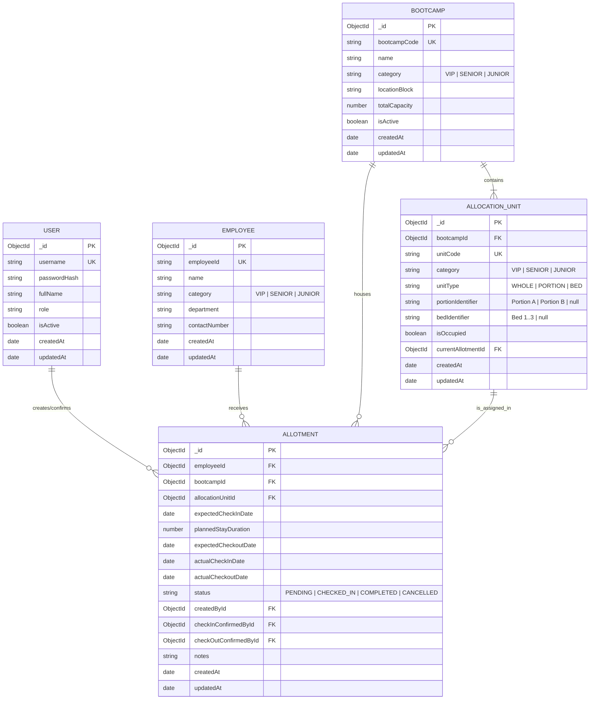

# Entity-Relationship (ER) Documentation
## Project: Al Haditha Hostel Allotment Management System

---

## 1. Relational Cardinality & Model Overview

The domain model connects employees, bootcamps, atomic allocation units, and their temporal allotment lifecycle.

### Key Relationships:
1. **User (Admin) to Allotment**:
   - `User (1) ---> (0..N) Allotments [Created]`
   - `User (1) ---> (0..N) Allotments [Check-in Confirmed]`
   - `User (1) ---> (0..N) Allotments [Checkout Confirmed]`
2. **Bootcamp to AllocationUnit**:
   - `Bootcamp (1) ---> (1..N) AllocationUnits`
   - *VIP*: 1 Bootcamp has 1 `WHOLE` AllocationUnit.
   - *Senior*: 1 Bootcamp has 2 `PORTION` AllocationUnits.
   - *Junior*: 1 Bootcamp has 6 `BED` AllocationUnits (3 per portion across 2 portions).
3. **Employee to Allotment**:
   - `Employee (1) ---> (0..N) Allotments` (Historical)
   - `Employee (1) ---> (0..1) Allotment` (Active: constrained by partial index)
4. **AllocationUnit to Allotment**:
   - `AllocationUnit (1) ---> (0..N) Allotments` (Historical)
   - `AllocationUnit (1) ---> (0..1) Allotment` (Active: constrained by partial index & `currentAllotmentId`)

---

## 2. Mermaid Entity-Relationship Diagram



---

## 3. Structural Breakdown per Category

### 3.1. VIP Allocation Hierarchy
```
+------------------------------------+
| Bootcamp: BC-VIP-01 (VIP)          |
| +--------------------------------+ |
| | AllocationUnit: BC-VIP-01-UNIT | |
| | Type: WHOLE                    | |
| | Capacity: 1 Employee           | |
| +--------------------------------+ |
+------------------------------------+
```

### 3.2. Senior Allocation Hierarchy
```
+--------------------------------------------------------------+
| Bootcamp: BC-SR-01 (SENIOR)                                  |
| +-----------------------------+ +--------------------------+ |
| | Unit: BC-SR-01-PA           | | Unit: BC-SR-01-PB        | |
| | Type: PORTION (Portion A)   | | Type: PORTION (Portion B)| |
| | Capacity: 1 Senior Employee | | Capacity: 1 Senior Emp   | |
| +-----------------------------+ +--------------------------+ |
+--------------------------------------------------------------+
```

### 3.3. Junior Allocation Hierarchy
```
+---------------------------------------------------------------------------------------------------+
| Bootcamp: BC-JR-01 (JUNIOR)                                                                       |
| +-------------------------------------------------+ +-------------------------------------------+ |
| | Portion A (Capacity: 3)                         | | Portion B (Capacity: 3)                   | |
| | +---------------+ +---------------+ +---------+ | | +---------+ +---------+ +---------------+ | |
| | | Unit: PA-Bed1 | | Unit: PA-Bed2 | | PA-Bed3 | | | | PB-Bed1 | | PB-Bed2 | | Unit: PB-Bed3 | | |
| | | Type: BED     | | Type: BED     | | Type:   | | | | Type:   | | Type:   | | Type: BED     | | |
| | | Capacity: 1   | | Capacity: 1   | | BED (1) | | | | BED (1) | | BED (1) | | Capacity: 1   | | |
| | +---------------+ +---------------+ +---------+ | | +---------+ +---------+ +---------------+ | |
| +-------------------------------------------------+ +-------------------------------------------+ |
+---------------------------------------------------------------------------------------------------+
```
This diagram demonstrates that checkout operations on `PA-Bed1` exclusively unlock `PA-Bed1` without mutating adjoining siblings.
